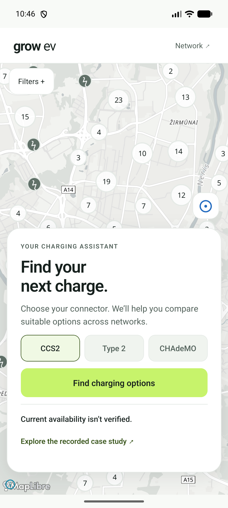
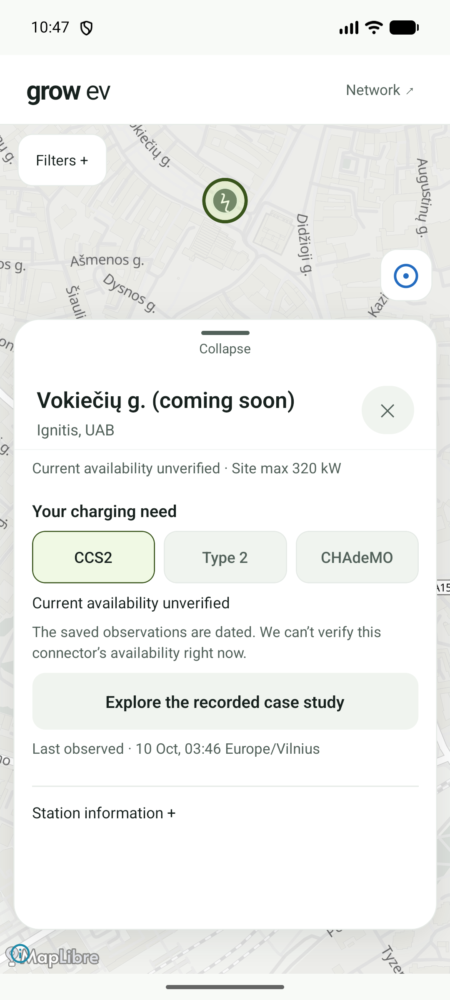
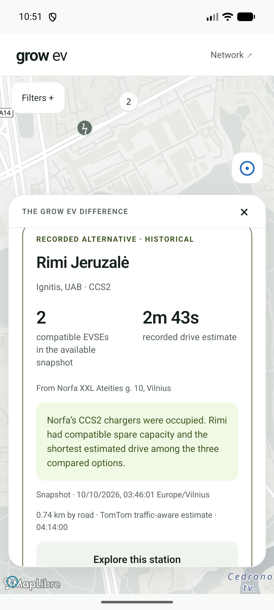
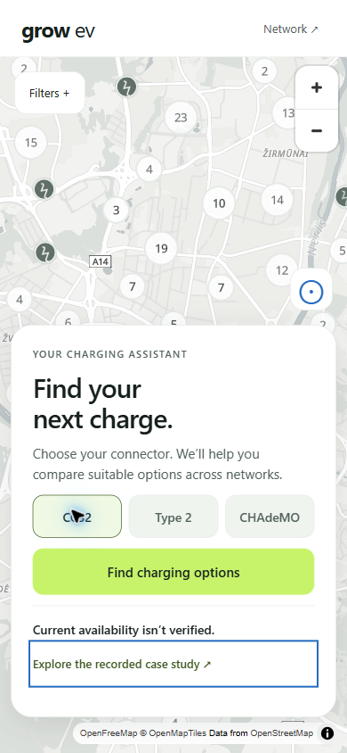
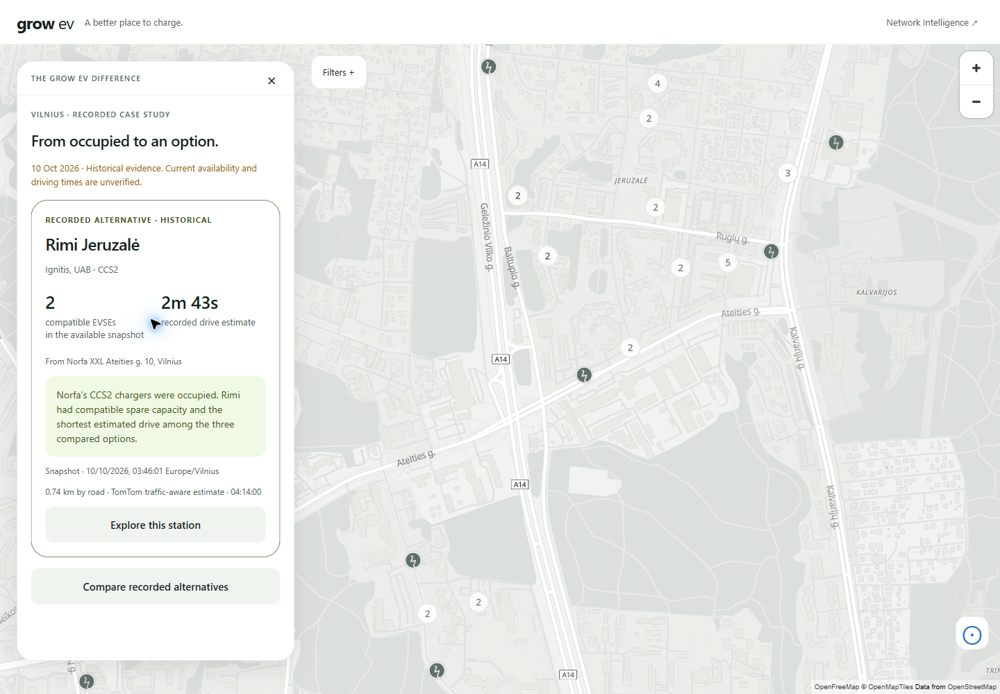
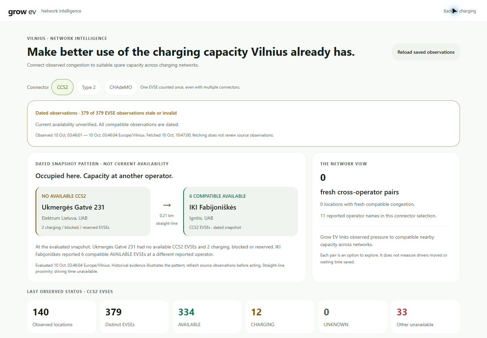

# TASK-010 — Implementation screenshots and review

Captured 10 October 2026 from the local production web export in connected Chrome
and the implemented Android debug app on Pixel_8 (1080 × 2400). Web dimensions are
CSS viewport pixels. These are actual application captures, not generated mockups.

## Required captures

| View | Capture | Review |
| --- | --- | --- |
| Android assistant home | [android-driver.png](android-driver.png) | One lime action, connector selection, stale notice and case entry visible; map and attribution retained. |
| Android selected station | [android-selected-station.png](android-selected-station.png) | Selected ring sits above the expanded sheet; readable connector/stale state; technical details disclosed on demand. |
| Android recommendation | [android-recommendation-historical.png](android-recommendation-historical.png) | Actual recorded Rimi evidence, compatible count, estimate, origin and date. Card is scrolled; lower action/alternatives require further internal scrolling. |
| Web 390 × 844 assistant | [web-390-driver.png](web-390-driver.png) | All home actions fit, no horizontal overflow; blue keyboard focus deliberately visible on case entry. |
| Web 1440 × 1000 recommendation | [web-1440-recommendation.png](web-1440-recommendation.png) | Bounded 400px decision panel with readable historical hero and visible actions; interactive map remains context. |
| Web 1440 × 1000 Network | [web-1440-network.png](web-1440-network.png) | Paired opportunity leads; freshness warning and zero fresh pairs are explicit; supporting metrics remain secondary. |

## Additional checks

`web-360-driver.png`, `web-768-driver.png`, `web-1280-driver.png` and
`web-1440-driver.png` document adaptive layouts. Document scroll width equalled
viewport width at all five required widths. The main web action measured 52px high;
connector controls measured 48px, with selected/pressed semantics. Keyboard traversal
exposed a solid focus outline. Browser reduced-motion emulation was exercised and
restored. `web-390-network-error-simulated.png` records an intentionally blocked RPC
response; the block was removed after the check. It is not a provider outage claim.

Chrome interaction covered find/select, connector switching, expansion, filters/power,
three historical alternatives, exploration of a recorded station using current evidence,
and Network navigation. Pixel_8 covered home, list/select, case and scroll interaction.

## Critical review and fixes

Home now presents a charging decision before map browsing. Mobile copy was shortened
to keep the primary action and honest stale state in view. Filter legend placement and
scrolling power chips prevent overlapping controls. Recentring accounts for the expanded
panel, keeping selected markers above the sheet. Desktop cards remain bounded rather
than stretching. A transient desktop capture before map tiles settled was replaced
with the fully rendered map capture. Long mobile recommendations intentionally scroll;
the sheet is not a claim that every detail fits simultaneously. Native map attribution
is retained through the MapLibre attribution control.

Visual hierarchy, legibility, spacing, action prominence and map/control positioning
were inspected in each required capture. User aesthetic acceptance and new-driver
five-second comprehension remain pending; no test result establishes those outcomes.

## Evidence boundaries

Recommendation screenshots use the separately labeled historical case from original
TASK-008 captured station/EVSE observations at 03:46 and TomTom estimates at 04:14
Europe/Vilnius. Numbers and timestamps were preserved. The case does not enter the live
engine or request routing. Current persisted observations are stale and cannot supply
fresh recommendations. Network shows the dated snapshot pattern with a freshness
warning and unchanged study-window coverage. No collector or provider request was run.

61 regression/evidence tests, TypeScript, zero-warning lint, web production export,
Android JS/Hermes export and offline debug assembly passed. Physical devices, real GPS,
fresh live routing, assistive-technology coverage and Android startup reliability remain
unverified. Prior intermittent Fabric crashes are not claimed fixed. See
`tasks/active/TASK-010.md` for commands and the review stop.
